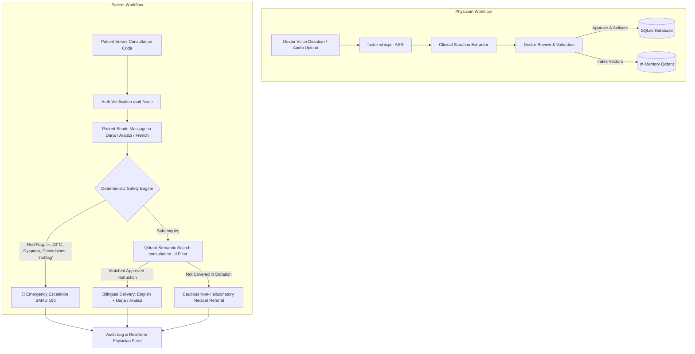

# 3awedhni عوضني — Care Dashboard & Patient Continuity Assistant

> **"You might think your doctor isn't there. Rethink about that."**  
> *Assistant post-consultation fondé exclusivement sur les consignes individuelles validées du médecin, avec compréhension native de la **Darja tunisienne**, de l'**Arabizi** et du **français**, moteur de sécurité déterministe et extraction clinique vocale.*

---

## 📌 Table of Contents
- [Overview & Clinical Mission](#-overview--clinical-mission)
- [Key Features](#-key-features)
- [System Architecture](#-system-architecture)
- [Repository Structure](#-repository-structure)
- [Quick Start Guide](#-quick-start-guide)
- [Physician Dictation & ASR Workflow](#-physician-dictation--asr-workflow)
- [Deterministic Safety & Red Flag Engine](#-deterministic-safety--red-flag-engine)
- [Bilingual Patient Assistant](#-bilingual-patient-assistant)
- [API Endpoints](#-api-endpoints)
- [Testing & Quality Assurance](#-testing--quality-assurance)
- [Ethical & Clinical Guardrails](#-ethical--clinical-guardrails)

---

## 🩺 Overview & Clinical Mission

In outpatient primary and pediatric care, **over 50% of verbal post-consultation instructions are forgotten or misremembered** within hours of leaving the clinic. In Tunisia, this problem is amplified by linguistic duality: doctors document in French, while parents ask urgent follow-up questions in **Tunisian Darja** or **Arabizi** via messaging apps.

**3awedhni_عوضني** bridges this critical gap:
1. **Zero Hallucination Guarantee**: The assistant never improvises generic medical advice or therapeutic changes. It answers **strictly and exclusively** from instructions approved by the attending physician for that exact consultation.
2. **Deterministic Safety Before AI**: High-risk signs (temperatures $\ge 40^\circ\text{C}$, respiratory distress, saliva swallowing compromise, convulsions, or explicit red flags) are caught deterministically *before* any LLM evaluation, immediately escalating the patient to emergency care (SAMU 190 / Pediatric Emergency).
3. **Local & Cloudless Resilience**: Fully operable on local infrastructure with **faster-whisper**, **Ollama (Qwen3)**, and **in-memory Qdrant**, ensuring privacy and zero downtime during network outages.

---

## ✨ Key Features

### 👨‍⚕️ 1. Physician Dashboard
- **Voice Dictation Recording**: Record dictations directly using the browser microphone or upload pre-recorded audio files (`.wav`, `.mp3`, `.m4a`, `.webm`, `.ogg`, `.mp4`).
- **Automated ASR & Multi-Situation Extraction**: Transcribes physician vocals with `faster-whisper` and segments multi-state dictations into structured clinical cards (e.g., Antibiotic adherence, Symptom relief, Red flag disposition).
- **One-Click Review & Approval**: Doctors review, edit, and validate instructions before they can ever be accessed by patients.
- **Patient & Consultation Management**: Create new patient records, prescribe individualized care plans, and generate secure consultation codes (e.g. `3AW-7K2-Q9`).
- **Clinical Oversight Feed**: Real-time triage feed of patient interactions categorized by outcome (`transmise`, `urgence`, `non_couverte`).

### 👶 2. Patient Assistant (Web & WhatsApp-Style)
- **Consultation Code Login**: Patients log in simply using their secure code (e.g., `3AW-7K2-Q9`) with zero demographic friction.
- **Bilingual Delivery**: Every message is formulated with clear **English on top** and the authentic translation (**Tunisian Darja / Arabizi / French**) underneath.
- **Tunisian Darja & Arabizi NLU**: Understands local colloquialisms (*"skhana"*, *"7al9ou"*, *"ma ynajjemch yetnafes"*, *"ri9ou ysil"*).
- **Negation Preservation**: Accurately recognizes Tunisian *ma...ch* negations (*"ma 3andouch skhana"* $\rightarrow$ child has no fever).
- **Explicit Red Flag Triggering**: Queries mentioning `"redflag"`, `"red flag"`, `"signe d'alerte"`, `"urgence"`, or `"khatar"` immediately trigger emergency triage.

---

## 🏗️ System Architecture



---

## 📂 Repository Structure

```text
3awedhni-care-dashboard/
├── src/
│   ├── routes/
│   │   ├── __root.tsx                           # Root layout with TanStack Start & Lovable config
│   │   ├── index.tsx                            # Doctor landing & authentication screen
│   │   ├── _dashboard.tsx                       # Dashboard layout & persistent navigation
│   │   ├── _dashboard.dashboard.tsx             # Clinical overview, stats & triage activity
│   │   ├── _dashboard.consultations.tsx         # Dictation recorder, transcription & review UI
│   │   ├── _dashboard.assistant-patient.tsx     # Bilingual patient chat & voice simulation
│   │   └── _dashboard.journal.tsx               # Compliance audit trail & safety log
│   │
│   ├── lib/
│   │   ├── api.ts                               # Backend client connecting to FastAPI (port 8000)
│   │   ├── care-store.tsx                       # Global state store synchronizing API data
│   │   ├── care-types.ts                        # TypeScript domain contracts
│   │   ├── clinical-extractor.ts                # Client-side multi-situation clinical parser
│   │   ├── events.ts                            # Audit & event aggregation utilities
│   │   ├── format.ts                            # Date, time & phone masking helpers
│   │   ├── safety-engine.ts                     # Client-side deterministic safety engine
│   │   └── safety-engine.test.ts                # Unit tests for clinical safety rules
│   │
│   └── components/
│       ├── ui/                                  # shadcn / Radix UI accessible primitives
│       └── dashboard/                           # Sidebar, event sheets, status badges
│
├── .env.example                                 # Template environment config
├── .gitignore                                   # Strict protection for keys, audio & .env
├── package.json                                 # Dependencies (React 19, TanStack Start, Tailwind v4)
├── tsconfig.json                                # Strict TypeScript settings
└── vite.config.ts                               # Vite & TanStack build configuration
```

---

## 🚀 Quick Start Guide

### Prerequisites
- **Node.js** (v18+) or **Bun** (recommended)
- Running **FastAPI Backend** on `http://localhost:8000` (see main repo backend)

### Installation
```bash
# Clone the repository
git clone https://github.com/MahdiBenHalima/3awedhni-care-dashboard.git
cd 3awedhni-care-dashboard

# Install dependencies with Bun
bun install

# Or with npm
npm install
```

### Environment Configuration
Copy `.env.example` to `.env`:
```bash
cp .env.example .env
```
Ensure your `.env` contains:
```env
VITE_API_BASE_URL=http://localhost:8000
```

### Running the Development Server
```bash
bun run dev
# Or: npm run dev
```
The dashboard will start on `http://localhost:8080` (or `http://localhost:5173`).

### Production Build
```bash
bun run build
# Or: npm run build
```

---

## 🎙️ Physician Dictation & ASR Workflow

1. **Audio Capture**: The physician speaks into their computer microphone or uploads a clinical audio recording.
2. **Audio Preprocessing**: Automatic conversion to 16 kHz mono PCM WAV via `ffmpeg` guarantees full acoustic fidelity.
3. **Dual-Pass Transcription**: `faster-whisper` decodes the French / Darja audio using Silero VAD, falling back to non-VAD decoding for soft speech.
4. **Clinical Segmentation**: The extractor automatically isolates:
   - **Antibiotic Compliance**: Duration, dosage schedule, and adherence warnings.
   - **Home Symptom Care**: Antipyretics, hydration, and soothing measures.
   - **🚨 Red Flags & Emergency Referrals**: Isolated into an urgent disposition card requiring immediate emergency consultation if triggered.
5. **Validation Gate**: No instruction is indexed or accessible to patients until the physician clicks *"I have reviewed — approve and activate instructions"*.

---

## 🛡️ Deterministic Safety & Red Flag Engine

The safety engine inspects all incoming queries **before any LLM inference**:

| Category | Triggers & Keywords (French / Darja / Arabizi / English) | System Action |
| :--- | :--- | :--- |
| **High Fever** | $\ge 40.0^\circ\text{C}$, 41°C, *"skhana 41"*, *"fièvre 40"* | 🚨 Immediate ER / SAMU 190 |
| **Respiratory Distress** | *"difficulté respiratoire"*, *"détresse"*, *"yetnafes b s3ouba"*, *"خنقة"* | 🚨 Immediate ER / SAMU 190 |
| **Airway / Saliva** | *"ma ynajjemch yebla3 ri9ou"*, *"impossible d'avaler sa salive"*, drooling | 🚨 Immediate ER / SAMU 190 |
| **Neurological Alert** | Convulsions, loss of consciousness, *"dayekh ma yfi9ch"*, *"تشنجات"* | 🚨 Immediate ER / SAMU 190 |
| **Explicit Red Flags** | `"redflag"`, `"red flag"`, `"urgence"`, `"emergency"`, `"signes d'alerte"`, `"khatar"` | 🚨 Immediate ER / SAMU 190 |
| **Prompt Injections** | *"ignore previous instructions"*, *"oublie les consignes"*, *"tu es médecin"* | 🚫 Blocked & Logged |
| **Fever Negation** | *"ma 3andouch skhana"*, *"pas de fièvre"* | ✅ Preserves negation (no false fever flag) |

---

## 💬 Bilingual Patient Assistant

Every response provided to patients follows an accessible bilingual format:

```text
According to your doctor's instructions for (Douleur de gorge):
📌 Keep taking the prescribed analgesics and offer soft or warm foods.

──────────────
حسب تعليمات طبيبكم المباشر بخصوص (وجيعة في الحلق) :
📌 واصل إعطاء المسكنات الموصوفة وقدّم ماكلة طرية ودافية.
```

If an emergency sign is detected:
```text
🚨 Immediate Medical Emergency: Red flag detected. Please seek emergency medical care immediately without delay. Go to the nearest pediatric emergency department or call emergency services (SAMU 190).

──────────────
🚨 حالة طارئة: تم رصد علامة خطر تستوجب فحصا طبيا مستعجلا فورا بدون انتظار. الرجاء التوجه فورا إلى قسم الاستعجالي أو الاتصال بالإسعاف 190.
```

---

## 🔌 API Endpoints (Backend Integration)

| Method | Endpoint | Description |
| :--- | :--- | :--- |
| `GET` | `/health` | Backend health check and database status |
| `POST` | `/auth/code` | Authenticate patient directly via consultation code |
| `POST` | `/physician/consultations` | Create a new patient consultation record |
| `POST` | `/physician/consultations/{id}/audio` | Upload physician audio dictation |
| `POST` | `/physician/consultations/{id}/transcribe` | Faster-Whisper ASR + Structured extraction |
| `POST` | `/physician/consultations/{id}/instructions` | Submit, validate, and index instructions to Qdrant |
| `POST` | `/patient/chat` | Authenticated patient chat with safety evaluation |
| `POST` | `/patient/call/simulated` | Simulated phone call with audio synthesis |

---

## 🧪 Testing & Quality Assurance

```bash
# Run Frontend Unit & Safety Engine Tests (16 passed)
bun test

# Type-check TypeScript code
bun x tsc --noEmit

# Production Build Verification
bun run build
```

---

## ⚖️ Ethical & Clinical Guardrails

1. **No Autonomous Diagnosis**: The assistant never attempts to diagnose conditions or initiate unprescribed treatments.
2. **Physician Primacy**: Every instruction must have an immutable `approved_by` and `approved_at` timestamp.
3. **Cross-Record Isolation**: Strict Qdrant payload filters (`must: [{ key: "consultation_id" }]`) ensure no patient can ever view another patient's clinical guidance.
4. **Full Traceability**: All interactions and safety escalations are persisted to the audit log for clinical governance.

---

<div align="center">
  <sub>Developed with ❤️ for Tunisian Healthcare Continuity — 3awedhni عوضني 2026</sub>
</div>
