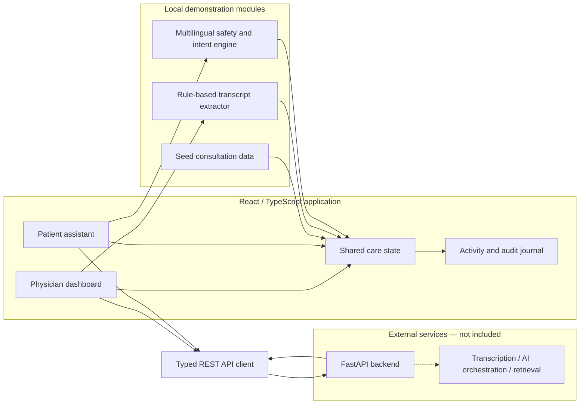
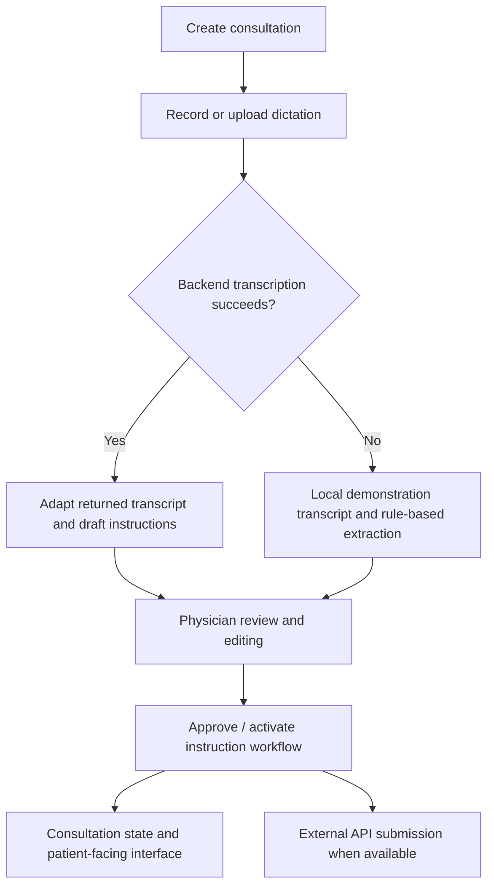
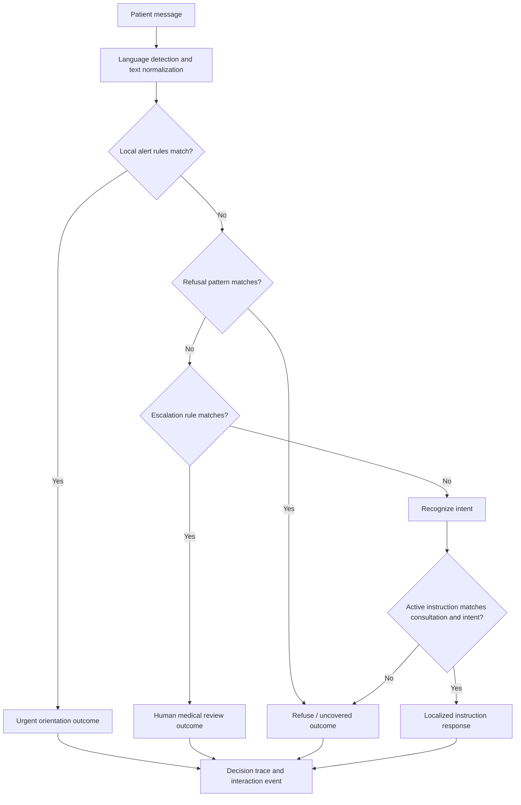

# 3awedhni — AI-Assisted Patient Care Continuity


**Multilingual patient assistance, clinical instruction workflows and safety-aware AI integration.**

3awedhni (عوضني) is an experimental digital health application exploring how structured physician instructions, multilingual conversational interfaces and rule-based safety mechanisms can support continuity of care after a consultation.

The project focuses on Tunisian Darja, Arabizi and French, with an English/local-language presentation layer in the patient assistant.

> **Scope:** This repository contains the React/TypeScript application, local rule-based extraction and safety logic, demonstration data, and a typed client for an external FastAPI backend. It is a software engineering prototype, not a clinically validated medical device or a production-ready patient service. Use synthetic data only.

## Table of Contents

- [Project objectives](#project-objectives)
- [Engineering contributions](#engineering-contributions)
- [System architecture](#system-architecture)
- [Clinical instruction workflow](#clinical-instruction-workflow)
- [Patient assistance and safety pipeline](#patient-assistance-and-safety-pipeline)
- [Backend integration](#backend-integration)
- [Technology stack](#technology-stack)
- [Repository structure](#repository-structure)
- [Getting started](#getting-started)
- [Testing and reproducibility](#testing-and-reproducibility)
- [Security and clinical limitations](#security-and-clinical-limitations)
- [Roadmap](#roadmap)

## Project objectives

Post-consultation instructions may be difficult to recall or understand, particularly when the language used in clinical documentation differs from the patient's everyday language.

3awedhni explores an instruction-centered approach rather than an unrestricted medical chatbot:

- Structure physician instructions into consultation-specific records.
- Provide an interface for clinicians to review, edit, activate and revoke instructions.
- Recognize selected multilingual patient queries and retrieve relevant active instructions.
- Apply explicit local safety rules and route uncovered situations toward human review.
- Record decision traces and interaction events for inspection.

The intended clinical workflow keeps the physician responsible for care decisions. The current implementation does not establish that these constraints are enforced securely in every execution path.

## Engineering contributions

| Capability | Implementation in this repository |
|---|---|
| Consultation management | Physician dashboard, consultation creation and structured instruction cards |
| Voice interaction | Browser microphone capture, audio upload and backend transcription client |
| Document/clinical intelligence | Rule-based segmentation of supplied transcript text into draft instruction records |
| Multilingual NLP | Pattern-based language detection, intent classification and selected negation handling |
| Safety-aware decision logic | Deterministic alert rules, refusal patterns and explicit decision outcomes |
| Human-in-the-loop workflow | Instruction editing, approval, activation and revocation interfaces |
| Contextual instruction matching | Local matching by consultation ID, active status and recognized intent |
| Patient-facing assistant | Chat interface, localized responses, instruction references and simulated voice-call integration |
| Backend interoperability | Typed FastAPI REST contracts, response adapters and health checks |
| Auditability | Interaction events, decision traces, source instruction identifiers and follow-up queue |
| Software quality | Vitest test cases for rules, event prioritization and application routing |

## System architecture

The repository supports two interaction paths: an external backend integration and a local demonstration fallback.



The external AI architecture described by the original project documentation includes faster-whisper, LangGraph, Ollama/Qwen3, Qdrant and SQLite. Their backend implementations are not contained in this repository, so model inference, vector retrieval, server-side authorization and persistence cannot be reproduced from this repository alone.

## Clinical instruction workflow



The browser implements microphone capture through MediaRecorder. Audio files can be submitted to the backend client for transcription. The local fallback is a text-processing demonstration, not a local speech recognition model: it can use a supplied or seeded transcript when transcription fails.

Instruction records represent a situation, an intended action, applicability and escalation conditions, language-specific replies, version information and activation metadata. Draft extraction uses keywords, text segmentation and rule templates; it is not guaranteed to preserve the exact source instruction. Human review is essential.

## Patient assistance and safety pipeline

The frontend first attempts backend chat when a session token and a healthy backend are available. Otherwise, the local demonstration calls the deterministic engine.



This diagram describes the local rule engine, not the unverified server-side execution order.

### Multilingual processing

The engine uses regular expressions and text normalization for French, Tunisian Arabic script, Arabizi and mixed-language input. It extracts selected temperature expressions, recognizes selected fever negations, maps common symptom-related intents and chooses localized response templates.

These are finite rules, not a trained multilingual language model. Code switching, ambiguous wording, spelling variations and contextual negation can produce incorrect classifications.

### Decision outcomes

| Outcome | Meaning in the application |
|---|---|
| `transmise` | Matching instruction returned |
| `urgence` | Alert rule matched |
| `escalade` | Rule requests human medical review |
| `non_couverte` | No matching instruction or request refused |

The local engine checks alert patterns before refusal and ordinary instruction matching. A matched instruction is filtered by consultation ID, active status and intent. This is application-level filtering, not a substitute for server-side authorization, nor does it independently verify approval provenance or clinical applicability.

### Traceability and follow-up

The event model associates consultation identifiers, outcomes, timestamps and instruction references with interaction records. Follow-up utilities prioritize urgent events, then escalations and uncovered requests. The dashboard and journal provide inspection views; local state and logs are demonstration features, not a durable or tamper-resistant clinical audit system.

## Backend integration

The following endpoints are referenced by the TypeScript API client. They describe the expected external service contract, not endpoints hosted by this repository.

| Method | Endpoint | Purpose |
|---|---|---|
| GET | `/health` | Connectivity check |
| GET / POST | `/physician/consultations` | List or create consultations |
| GET | `/physician/consultations/{id}` | Retrieve consultation and instructions |
| GET | `/physician/dashboard` | Dashboard data |
| GET | `/physician/audit-logs` | Audit entries |
| POST | `/physician/consultations/{id}/audio` | Upload dictation |
| POST | `/physician/consultations/{id}/transcribe` | Request transcription and extraction |
| POST | `/physician/consultations/{id}/instructions` | Submit instructions |
| POST | `/physician/instructions/{id}/approve` | Approve instruction |
| POST | `/physician/instructions/{id}/revoke` | Revoke instruction |
| POST | `/auth/start`, `/auth/code`, `/auth/verify` | Patient authentication integration |
| POST | `/patient/chat` | Patient messaging |
| POST | `/patient/call` | Simulated voice-call integration |

The client maps server response contracts into frontend domain types. Backend-dependent ASR, LLM orchestration, embeddings, retrieval and voice synthesis require a separately configured implementation.

## Technology stack

| Layer | Technologies |
|---|---|
| Frontend | React 19, TypeScript, TanStack Start, TanStack Router |
| Styling and UI | Tailwind CSS 4, Radix UI, shadcn-style components, Lucide |
| State management | React Context, hooks, sessionStorage |
| Local processing | TypeScript, regular expressions, deterministic rules |
| Audio | Browser MediaRecorder, Blob and multipart uploads |
| Backend integration | Fetch API, REST, FastAPI contracts |
| Development | Vite, Bun, ESLint, Prettier |
| Testing | Vitest, Testing Library, jsdom |

## Repository structure

```text
3awedhni/
├── src/
│   ├── routes/
│   │   ├── index.tsx                        # Demonstration physician login
│   │   ├── _dashboard.tsx                   # Dashboard layout
│   │   ├── _dashboard.dashboard.tsx         # Overview and activity
│   │   ├── _dashboard.consultations.tsx     # Audio and instruction workflow
│   │   ├── _dashboard.assistant-patient.tsx # Patient chat and voice interface
│   │   └── _dashboard.journal.tsx           # Audit and follow-up views
│   ├── lib/
│   │   ├── api.ts                           # External backend client
│   │   ├── care-types.ts                    # Domain contracts
│   │   ├── care-store.tsx                   # Shared application state
│   │   ├── clinical-extractor.ts            # Local rule-based extraction
│   │   ├── safety-engine.ts                 # Local decision rules
│   │   ├── safety-checks.ts                 # Demonstration checks
│   │   ├── events.ts                        # Follow-up and event utilities
│   │   ├── seed-data.ts                     # Demonstration records
│   │   ├── safety-engine.test.ts            # Rule regression cases
│   │   └── events.test.ts                   # Event and follow-up cases
│   ├── components/                          # Reusable UI and dashboard components
│   └── test/                                # Routing test and setup
├── .env.example
├── package.json
├── bun.lock
├── vite.config.ts
├── vitest.config.ts
└── README.md
```

## Getting started

### Prerequisites

- Bun, or a Node.js version compatible with the repository's Vite 8 toolchain.
- A modern browser; microphone access requires browser permission and a secure context (localhost is suitable for development).
- An external compatible backend only for server-dependent functionality.

### Install and run

```bash
git clone https://github.com/MahdiBenHalima/3awedhni.git
cd 3awedhni
bun install
```

Copy `.env.example` to `.env` and configure the optional backend address:

```env
VITE_API_BASE_URL=http://localhost:8000
```

```bash
bun run dev
```

Open the URL printed by Vite. Use only the application's demonstration records. Do not enter real patient names, contact details, clinical notes or audio. The frontend includes simulated authentication and fallback paths that are not suitable for use with sensitive information.

### Production build command

```bash
bun run build
```

This command builds the frontend application; a successful build alone does not imply production security or clinical readiness.

## Testing and reproducibility

```bash
bun run test
bun run lint
bun run build
```

The package defines the test script as `vitest run`. The repository contains 16 test cases across three files:

| Test file | Cases | Coverage |
|---|---:|---|
| safety-engine.test.ts | 11 | Multilingual matching, alert precedence, selected negation, refusal, inactive instructions and consultation filtering |
| events.test.ts | 4 | Follow-up ordering, completion and measured versus unmeasured checks |
| app-routing.test.tsx | 1 | Root route matching |

**Validation status:** Test cases were inspected during this documentation revision, but the test suite and production build were not executed. No pass rate, clinical sensitivity, specificity, model quality or latency benchmark is claimed. The tests establish intended behavior for selected examples only.

## Security and clinical limitations

The application is an engineering demonstration and must not be relied on for diagnosis, treatment, emergency triage or real patient record handling.

- Physician login and patient fallback authentication contain demonstration shortcuts. Server-side identity verification and strict access control are required before real use.
- The fallback can accept an unmatched code format and select a default consultation. This is not secure patient isolation.
- Session storage and frontend state are not suitable substitutes for protected clinical records.
- The local matcher does not independently enforce all approval and applicability conditions; extraction can introduce template content not stated in the source.
- Rule-based safety detection and prompt-injection patterns can miss or misclassify inputs; they cannot guarantee safety or prevent all attacks.
- The external backend, its authorization, storage, retrieval and model behavior are outside this repository's verification scope.
- Clinical validation, privacy review, threat modeling and applicable regulatory assessment are required before any real deployment.

## Roadmap

- Replace demonstration authentication with server-enforced identity and consultation authorization.
- Fail closed when backend authentication or transcript processing fails.
- Separate synthetic demonstration mode from connected operation.
- Require verifiable physician approval and source evidence for every deliverable instruction.
- Expand multilingual regression cases and evaluate false positive/negative behavior.
- Add integration tests for backend contracts, authorization and consultation isolation.
- Establish automated CI checks and reproducible backend integration documentation.
- Evaluate clinical safety with qualified healthcare professionals before any real-world use.

---

**Mahdi Ben Halima** — [GitHub portfolio](https://github.com/MahdiBenHalima)

Research interests: AI Engineering · Multilingual NLP · Human-in-the-Loop AI · Intelligent Workflow Automation · Digital Health
